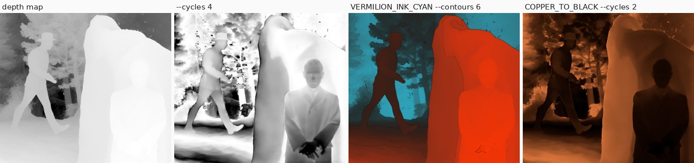
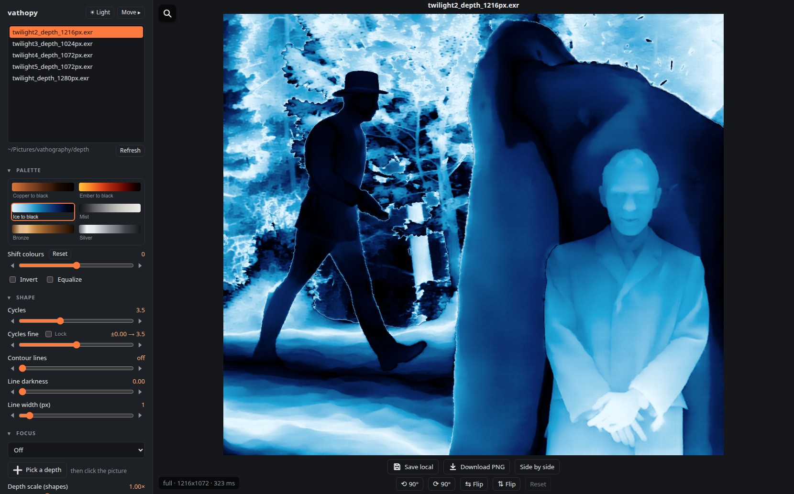
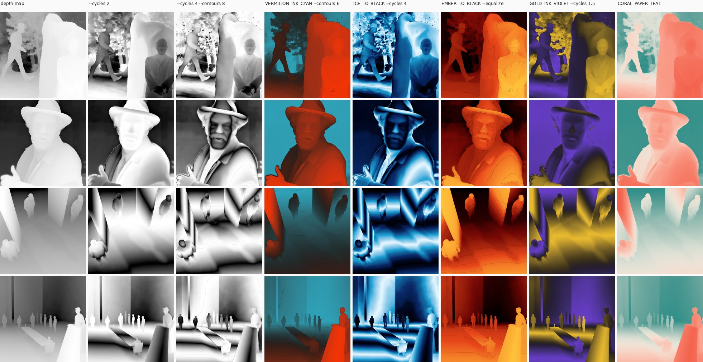

# vathopy

Vathography pictures from depth maps, without Blender. [Vathography](https://vathography.com/) is a practice
by Karim Joseph Nassar: a photograph's inferred depth becomes the artwork, with a *creative focus* deciding
which distances become the subject.

`vathopy` is a Python port of the picture maths of the free **Vathography** Blender add-on
(v1.0.95, © 2026 Karim Joseph Nassar). It covers the colour ramp, the depth controls, the ramp
tilt, the Focus & Shape Bands and the Focus & Shape Areas (Add, Merge and Mask modes). Given the
same depth map and settings, it produces the same picture as the add-on's artistic export.

On top of that it adds things the add-on doesn't have, all off by default: cycles and contour lines,
smoothing, anti-aliasing and equalizing, a creative focus picked by depth (as tilted planes or 3D shapes),
a deletion slab and deleted parts, orientation, selections with their own palette, a photo overlay, a
viewpoint shift, exaggerated depth, 65
palettes plus your own, a web GUI with a 3D view, and 3D-printable reliefs and lithophanes (STL), flat or
wrapped round a cylinder or a sphere.

It runs on any Linux machine with Python 3.10+, numpy, OpenCV and OpenEXR. No GPU is needed: a
24-megapixel picture renders in a few seconds on the CPU.



## Install

```bash
python3 -m venv .venv && . .venv/bin/activate
pip install -r requirements.txt   # numpy, OpenCV (headless), OpenEXR
pip install -e .                  # from this folder; installs the `vathopy` command
pip install -e '.[test]'          # optional: pytest
pip install -e '.[examples]'      # optional: Pillow, for tools/make_examples.py
```

## Typical pipeline

```bash
# 1. Raw Marigold V2 prediction (.npy, float) -> clean depth map: near = bright, outliers clipped,
#    invalid pixels filled. Kinds: log (default), linear, disparity, near-bright, far-bright.
vathopy prep photo.npy --kind log -o photo_depth.exr

# 2. Render a look onto it (16-bit PNG by default; also png8, or exr for unclipped scene-linear).
vathopy init my_look.json --preset FRINGE_3_BW     # a starter look to edit
vathopy render photo_depth.exr -l my_look.json -o photo_vathograph.png

# Batch: several inputs into a folder; override the ramp without editing the look.
vathopy render shots/*_depth.exr -l my_look.json --preset VERMILION_INK_CYAN -o out/

vathopy presets    # 65 ramp presets: the add-on's 19, 8 complementary palettes, 13 colour-to-black, MIST,
                   # 5 metallic, 19 from scientific and thermal-camera colour maps
```

### Your own palettes

The 65 built-in palettes live in `src/vathopy/presets.json`. Besides the add-on's and vathopy's own, there are
five metallic ramps (Bronze, Silver, Gold, Chrome, Mercury: shadow, body colour, a bright glint, and a darker
reflection near, so surfaces read as polished metal, rippling with `--cycles`), and colour maps fitted to at most
32 stops (within 4/255 of the originals, a little more for the hue wheels): the perceptually even Magma,
Inferno, Plasma, Viridis and Cividis, the cyclic Twilight, the Turbo rainbow, and thermal-camera false-colour
LUTs from [boson_lut](https://github.com/dannen/boson_lut) (Iron black, Lava, Arctic, Blue lila flame, Electric
blue, Neon, the isotherms Fire and ice, Black hot blue and Mid-range isotherm, Rainbow graded, Colour wheel 6,
Go 4-step). `tools/add_palettes.py BOSON_LUT_DIR` regenerates them. To add your own, put files in a palette folder:
`~/Pictures/vathography/palettes` by default, or `$VATHOPY_PALETTES`, or `vathopy --palettes DIR ...` (before
the command). Each file becomes a palette named after it, upper-cased (`sunset glow.png` → `SUNSET_GLOW`),
listed after the built-ins in `vathopy presets` (marked `[yours: …]`) and in the GUI (marked ★). The GUI re-reads
the folder whenever the page loads, so a new file shows up on a reload.

```bash
mkdir -p ~/Pictures/vathography/palettes
cp examples/palettes/* ~/Pictures/vathography/palettes/     # DUSK (an image) and FOG_GREEN (JSON)
vathopy presets | tail -2
vathopy render depth.exr --preset DUSK -o out/
```

Three ways to make one:

- **An image** (`.png` or `.jpg`): the easiest. Paint or crop a strip and save it; vathopy
  reads it along its long side, **left = near, right = far** (top = near for a tall strip), the way the GUI's
  swatches run. It reads the middle half of the strip, so a border or a label at the edge doesn't count.
  - **Colour blocks** (like `examples/palettes/dusk.png`: five flat blocks): each block becomes one colour stop,
    and the ramp blends between them.
  - **A smooth gradient** (a screenshot of one, a sky, a photo's colour bar): it's sampled into at most 32
    stops (Blender's limit), so it keeps its shape.
- **JSON**, the built-in format, for exact control: positions run from 0 = far to 1 = near, colours are sRGB hex,
  and `interpolation` is `LINEAR`, `EASE`, `CONSTANT` (hard bands), `B_SPLINE` or `CARDINAL`:

  ```json
  {"name": "Fog green", "desc": "Near deep green, far pale fog", "interpolation": "EASE",
   "stops": [[0.0, "#E9EEE8"], [0.45, "#9FB3A2"], [1.0, "#16302A"]]}
  ```

  One file can also hold several, keyed by name: `{"warm": {...}, "cold": {...}}` → `WARM` and `COLD`.
- **A GIMP palette** (`.gpl`, which many palette sites and apps export): its colours are spread evenly, the first
  one near and the last one far.

A file whose name matches a built-in palette is skipped with a warning (rename it), as is a file vathopy
can't read; other file types in the folder are ignored. Looks saved with your palette refer to it by name, so
the palette has to be in the folder wherever the look is rendered again.

**Safety.** Palette files are only ever read as data: JSON is parsed, never evaluated; `.gpl` lines are split
into numbers; images are decoded to pixels. Nothing in them is run, and the GUI shows their names as plain
text, never as HTML. Data can still be hostile, so every file is checked first and rejected, with the reason,
unless it passes:

- only regular files in the folder itself (symlinks aren't followed, so a link can't pull in a file from elsewhere);
- at most 200 palette files; images up to 20 MB, `.json`/`.gpl` up to 256 KB;
- images only as PNG or JPEG, with the size read from the file header **before** decoding and capped at
  25 megapixels, so a tiny file claiming a huge picture (a decompression bomb) is refused;
- 1–32 stops, positions finite numbers from 0 to 1, colours exactly `#RRGGBB`, a known interpolation;
- names and descriptions stripped of control characters (terminal escape codes, hidden text-direction marks)
  and shortened; keys reduced to `A–Z`, `0–9` and `_`; built-in palettes are never replaced.

Test a folder before using it (it exits with an error if anything is rejected):

```bash
vathopy check-palettes ~/Downloads/new-palettes
vathopy check-palettes            # the palette folder itself
```

```
OK        dusk.png        DUSK: 5 stop(s), LINEAR
REJECTED  huge.png        60000 x 60000 pixels; at most 25 megapixels
REJECTED  link.json       not a regular file (symlinks aren't followed)
```

### How it works: the relief and the focal planes

The depth map becomes a **relief**: a surface in 3D whose left-right and up-down are the picture's and whose
height is the depth (near = high). The palette is painted onto that height, its left end (as the GUI shows a
swatch) on the nearest parts, its right end on the farthest, so in a plain render brightness means nearness,
not focus. Cycles repeat the palette through the depth, and the fringes are lines of equal depth.

A **focus** is a slab: a plane with a thickness (Width) and a soft edge (Softness), lying across the relief at
one depth, or tilted with Lean and Angle. Wherever the relief passes through the slab the picture is lifted to
white or sunk to black; with the white-on-black style everything else is black, so there bright does mean "in
focus". That slab is the add-on's Focus & Shape Band; "focal plane" is a good name for it.

vathopy can bend that plane into a **3D shape** (below), and cut the relief away from the far side with the
**deletion slab**. The relief can also be printed (see 3D printing). Depth from Marigold is relative, not
measured, so shapes are round in the relief, not in real-world units; Depth scale sets how deep the scene is
compared with its width.

### Shape focuses

A focus can be a sphere/ellipsoid, a box, a cylinder (a rod) or a double cone instead of a plane, placed at the
picked point and depth and turned with Lean/Angle (the cone's axis; the box's turn). A cylinder is a rod that
stands upright in the picture: Turn lays it over (90 = left-right), Tilt leans it towards you (90 = pointing at
you), Length is its height (0 = endless), and Depth moves it forward or back. **Shell**
lights a skin of the shape Width thick, the focal plane bent into the shape: rings and outlines where the scene
crosses it. **Solid** lights everything of the scene inside it. Sizes, Width and Softness are fractions of the
picture's width.

```bash
vathopy render depth.exr --base BLACK --focus @410,480:shape=ellipsoid:size=0.12:width=0.015 -o out/   # a ring
vathopy render depth.exr --base BLACK --focus @410,480:shape=box:size_x=0.1:size_y=0.2:size_z=0.1:fill=solid -o out/
vathopy render depth.exr --base BLACK --focus @410,480:shape=cone:cone=25:lean=60:angle=90 -o out/     # a beam
vathopy render depth.exr --base BLACK --focus @410,480:shape=cylinder:size=0.05:length=0.6 --depth-scale 2 -o out/
```

### The deletion slab

`--cut C` removes everything farther than C (0 = far … 1 = near, over the depth range) and turns it black or
white (`--cut-fill`), softly with `--cut-softness`. `--cut-near N` does the same from the near side: it removes
the nearest N of the depth range (0 = nothing, 1 = everything). Together they leave a band of depths. At 1
everything goes, except the **keep shapes**: spheres, boxes, rods or cones (`--keep`, the same fields as a shape
focus) that the cut leaves alone.

```bash
vathopy render depth.exr --cut 0.4 -o out/                                   # drop the background
vathopy render depth.exr --cut-near 0.3 -o out/                              # drop the foreground
vathopy render depth.exr --cut 0.3 --cut-near 0.3 -o out/                    # keep only the middle depths
vathopy render depth.exr --cut 1 --keep @950,480:size=0.25 -o out/           # only what's in a sphere around one person
```

The cut's `remove` list deletes whole things picked on the picture, whatever their depth: each part grows from its
`point` up to its depth edges like a selection (below), but only over what the slab has left, so a click on a
patch the slab didn't quite reach takes just that patch. Thin slivers left along its edge go with it. Keep
shapes don't hold on to removed parts. In a look: `"cut": {"depth": 0.21, "remove": [{"point": [0.5, 0.03]}]}`.

### Selections

A selection picks out a person or thing by its depth, and gives it its own palette and cycles. It grows from a
point (`point`, fractions of the picture, top-down) over neighbouring pixels whose depth changes by at most
`step` (a fraction of the depth range) from one pixel to the next, so it stops at depth edges such as someone's
outline. Lower `step` stops at fainter edges. `range` also keeps it within that much depth of the point,
`floors` stops it spreading onto ground that comes nearer going down the picture (the floor under someone's
feet), `grow` widens it by some pixels and `softness` feathers its edge. Small pockets left inside are filled.
`invert` selects everything else. There's no `render` flag for it: put it in a look (`-l`), or use the GUI.

```json
{"ramp": {"preset": "WHITE_TO_BLACK"}, "cycles": 2,
 "selections": [{"point": [0.25, 0.5], "step": 0.003, "floors": true, "ramp": {"preset": "COPPER_TO_BLACK"}, "cycles": 3}]}
```

It works from depth alone, so a person standing against a wall at the same depth can't be told from it; lower
`step` helps where there's a small depth step between them. The growth runs on the depth map at most 1536 px
across, so a preview and the full render select the same pixels.

### Photo overlay

`overlay` blends the photo the depth map was made from over the picture, under the cut: `opacity` 0–1, `mode`
`normal`, `multiply`, `screen` or `soft_light`, `where` `all`, `selections` (only inside them) or `outside`, and
`grey` for black and white, `invert` for its negative, and `enabled` (false keeps the settings but hides it).
The photo isn't stored in the look; give it to `render`:

```bash
vathopy render depth.exr -l look.json --photo photo.jpg --overlay 0.4 -o out/
```

It's resized to the depth map and turned upright from its EXIF orientation. The GUI finds it by name (below).

### Viewpoint shift

`view_shift` looks at the scene from a little to one side: `{"x": -1..1, "y": -1..1, "strength": 0.05, "pivot":
0.5, "edges": "zoom"}`. Each pixel moves by its depth, near ones one way and far ones the other, as if the camera
moved right (x > 0) or up (y > 0); `strength` is how far, as a share of the picture's width, and the depth at
`pivot` (0 = far … 1 = near) stays put. The soft in-between pixels along depth edges are left out (they'd smear
across), and the gaps that open behind near things are filled smoothly from the background beside them. With
`edges` `zoom` the picture is enlarged just enough that the strips the move uncovers along its borders (where
there's no data) fall outside it; `fill` keeps the framing and fills them too. It acts on the depth map (and
the overlay photo) first, so fringes, focuses and the cut all follow the new view; focus points, keep shapes and
selections stay where they were picked.

### Exaggerated depth

`exaggerate` makes the relief more pronounced: `{"amount": 0-10, "size": 0.002-0.2, "enabled": true}`. Each pixel's difference
from its smoothed surroundings (over `size` × the picture's width) is multiplied by 1 + `amount`, so faces,
folds and bumps stand out more, while the steps between things (more than 5% of the depth range) stay as they
are, with no halos. The result is scaled back into the depth's own range. It also amplifies the depth model's
own fine noise; a little smoothing (`smooth_depth`, applied first) keeps that down. `vathopy relief` uses it
too (the look's, or `--exaggerate A --detail-size S`).

### 3D printing

`vathopy relief` writes a binary STL (millimetres) of a closed solid on a flat base, ready for a slicer:

```bash
vathopy relief depth.exr -o relief.stl --width-mm 100 --relief-mm 8 --base-mm 2 --smooth-depth 2
vathopy relief depth.exr -o mould.stl --invert                                # far raised
vathopy relief depth.exr -o lithophane.stl --lithophane -l saved.png --min-mm 0.8 --max-mm 3
```

A **relief** raises the near parts `--relief-mm` above the far ones. A **lithophane** prints a rendered look
(from `-l`: a look, or a PNG the GUI saved) as thickness, dark parts thick and light parts thin, so it shows
the picture when lit from behind. Points are 0.2 mm apart by default (`--px` sets how many across, never more
than the map has; `--px 0` uses every pixel); a 100 mm print is about 450,000 triangles, 22 MB, and every pixel
of a 2496 px map about 9.4 million, 470 MB (the most is 12 million). More points only help if the printer can
show them (resin, or a bigger print); `--exaggerate` brings out detail that's there but shallow. The look's
orientation is used.

`--wrap cylinder` or `--wrap sphere` wraps it round instead: the picture's width goes `--arc-deg` round the axis
(360, the default, joins its two ends), its height keeps the picture's proportions (on a sphere `--lat-deg` sets
it; 180 runs pole to pole, closed at the poles), and the relief stands out from `--radius-mm` with a
`--base-mm` thick wall inside it. A lithophane wrapped round a cylinder is a lamp shade.

```bash
vathopy relief depth.exr -o vase.stl --wrap cylinder --radius-mm 40 --relief-mm 5 --base-mm 2
vathopy relief depth.exr -o globe.stl --wrap sphere --radius-mm 30 --arc-deg 180
vathopy relief depth.exr -o shade.stl --wrap cylinder --lithophane -l saved.png --min-mm 0.8 --max-mm 3
```

### Creative focus

Pick the distances that become the subject. Each `--focus` lifts one depth to white (or sinks it to black):

```bash
vathopy render depth.exr --base BLACK --focus 0.55:0.04:0.03 -o out/      # a white subject on black
vathopy render depth.exr --base BLACK --focus @410,480 -o out/            # the depth under pixel (410, 480)
vathopy render depth.exr --preset MIST --focus @410,480 -o out/           # lifted out of a misty gradient
vathopy render depth.exr --base BLACK --focus @410,480 --focus 0.9:0.1:0.05:0.6 -o out/   # several distances, the second at 60%
vathopy render depth.exr --base WHITE --focus 0.8:0.15 --focus-strength -1 -o out/   # black on white
vathopy render depth.exr --base BLACK --focus @410,480:reach_w=0.16:reach_h=0.5 -o out/   # one subject, isolated
vathopy render depth.exr --preset MIST --focus 0.6:angle=135:lean=60 -o out/   # a leaned band: a shaft of light
```

The practice's three kinds of focus: a **gradient** across the whole depth (`--preset MIST`, no focus), **one
subject isolated** (`--base BLACK` and a focus with a reach), and **several distances at once** (repeat `--focus`).


- **`--focus DEPTH[:WIDTH[:SOFTNESS[:STRENGTH]]]`**: DEPTH is a fraction of the depth range (0 = far, 1 = near),
  WIDTH the range that's fully in focus and SOFTNESS the fade on each side, as fractions too (default 0.1 and
  0.05). STRENGTH (-1 to 1) sets that focus alone. `@X,Y` instead of DEPTH takes the depth under that pixel
  (top-down coordinates of the depth map). Repeat `--focus` for several distances. Any field can also be
  named, in any order: `width=`, `softness=`, `strength=`, plus:
  - **`reach_w=` / `reach_h=`** (or `reach=` for both): confine the focus to an oval around the picked point,
    its half-width and half-height as fractions of the picture (0 = unlimited). Only that subject lights up,
    with a pool of light where the oval meets the ground, instead of everything at that depth.
    **`reach_edge=`** (0–1, default 0.5) softens the oval's edge towards a glow.
  - **`lean=`** (−90 to 90°, 0 = flat) tilts the band away from flat, so it cuts across the scene at an angle,
    like a shaft of light across a floor, through the picked point; negative leans tilt it the other way, and at
    ±90° it stands upright and ignores depth, a straight stripe across the picture. **`angle=`** (degrees,
    0 = right, 90 = up) turns it (any value; the GUI's slider runs −90 to 90°, since a negative lean covers the other
    half of the circle).
- **`--base`** sets what the focus sits on: `RAMP` (default, the palette), `BLACK` or `WHITE`.
- **`--focus-strength K`** (-1 to 1, default 1) for every focus without its own STRENGTH: 1 lifts to white, -1
  sinks to black, in between is partial.
- **`MIST`** is a ramp for the third kind of focus: near dark, distance pale like mist.

Each focus is the add-on's own Focus & Shape Band at that depth (flat, or leaned), and a reach is the
add-on's mask area (an ellipsoid set to Keep) aimed at that band, so it renders exactly like the same setup
placed in Blender. Look key: `"focus": [{"depth": 0.55, "width": 0.04, "softness": 0.03}]` (or `"at": [x, y]`),
plus optional `"strength"`, `"enabled"`, `"lean"`, `"angle"`, `"pivot": [fx, fy]` (the point a leaned band or a
reach is centred on, as fractions of the picture; `at` sets it), `"reach_w"`, `"reach_h"`, `"reach_edge"` and
`"locked"` (the GUI's lock; no effect on the picture).

### Cycles and contour lines

Two render options that the add-on doesn't have (`N` is 1 to 10 in steps of 0.25):

```bash
vathopy render depth.exr --cycles 4 -o out/                                  # black/white 4-cycle fringe
vathopy render depth.exr --preset VERMILION_INK_CYAN --cycles 2.5 -o out/    # the colours repeat 2.5 times
vathopy render depth.exr --preset VERMILION_INK_CYAN --contours 5 -o out/    # gradient kept, 5 contour lines
vathopy render depth.exr --preset VERMILION_INK_CYAN --contours 5 --contour-strength 0.6 --contour-width 3 -o out/
```


- **`--cycles N`** repeats the ramp N times across the depth, mirroring every other repeat so there are no seams. One cycle is there and back, so whole numbers end on the ramp's far colour at the near end; use a half step (1.5, 2.5, …) to end on its near colour. With no `--preset` or look ramp it uses a black/white EASE ramp, which is the N-cycle fringe: more cycles means more contour bands. On smooth surfaces (floors, walls, open ground) 4–6 cycles read well; on noisy depth (sky, foliage, film grain) more cycles mostly magnify the noise.
- **`--contours N`** keeps the ramp as it is (so colour still means distance) and draws thin dark lines at N even steps through the depth, like a topographic map. `--contour-strength` (0–1, default 0.85) sets how dark they are, and `--contour-width` (pixels, default 2) their thickness. Lines keep that width everywhere: steep and gentle slopes alike, and on nearly flat surfaces where a depth-based width would smear into a wide band. Where many lines crowd into a pixel (steep depth edges) it gets their average darkness, and perfectly flat areas (such as the plateaus `prep` clipping leaves at the nearest and farthest values) get no line, just one around their rim.


Both are also look keys: `"cycles": 2.5` and `"contours": {"cycles": 5, "strength": 0.85, "width": 2}`. They're off by default, so other looks render exactly as before.

### Smoother contours

```bash
vathopy render depth.exr --preset VERMILION_INK_CYAN --contours 8 --smooth-depth 4 --supersample 3 -o out/
```

- **`--smooth-depth R`** smooths the depth map before rendering with an edge-preserving (bilateral) filter, radius R px (try 2–6). Small depth noise inside surfaces is evened out, so contour lines and fringes follow the surfaces in smooth curves instead of breaking up, while the steps between objects stay sharp. This is the main fix for ragged contours, especially on noisy depth (film scans, foliage, sky).
- **`--supersample N`** (1–4) anti-aliases: it renders at N× the resolution and averages back down, so line and edge pixels get in-between values instead of hard steps. It softens stair-stepped edges. It costs about N² in time, which is still well under a second per 1280 px picture at N = 3.


Both apply to everything (contours, cycles, bands, area edges), are look keys (`"smooth_depth": 4`, `"supersample": 3`), and are off by default. The output is always the depth map's own size.

### GUI: try looks with sliders

A small local web app (Python standard library server + one HTML page, no extra dependencies):



#### Starting it

From the vathopy folder, with the venv from Install:

```bash
.venv/bin/vathopy gui           # or `vathopy gui` with the venv activated
```

Then open http://127.0.0.1:8770/ in a browser. It prints the folders it uses and the address, and keeps
running in that terminal.

#### Stopping it

Press **Ctrl+C** in its terminal. If you started it in the background (below), stop it with
`pkill -f 'bin/vathopy gui'`. Closing the browser tab doesn't stop it.

To run it in the background, with its messages in a log file:

```bash
nohup .venv/bin/vathopy gui > ~/vathopy-gui.log 2>&1 &
```

#### Folders and options

| Option | Default | What it is |
|---|---|---|
| `--depth-dir DIR` | `~/Pictures/vathography/depth` | Where it reads depth maps (`.exr`, raw Marigold output) |
| `--favourites DIR` | `~/Pictures/vathography/favorites` | Where **Save** and **Save local** write PNGs, and **Save** writes looks (`looks/<name>.json`); saved looks are listed from here |
| `--palettes DIR` | `~/Pictures/vathography/palettes` | Your own palettes (see "Your own palettes"). It goes **before** `gui`; `$VATHOPY_PALETTES` works too |
| `--port N` | `8770` | The port; use another to run two at once |
| `--host ADDR` | `127.0.0.1` | The listen address; `0.0.0.0` makes it reachable from the network (set a password) |
| `--preview-size N` | `1280` | The largest preview, in px, while a slider is dragged |
| `--photos DIR` | `input` beside `--depth-dir` | Where the photos the depth maps were made from are, for **Photo** (searched with subfolders) |

For example, another set of depth maps, saving somewhere else, on a second port:

```bash
.venv/bin/vathopy --palettes ~/my-palettes gui --depth-dir ~/scans/depth --favourites ~/scans/looks --port 8771
```

The folders are fixed while it runs: to change them, stop it and start it again with new options. New depth
maps added to `--depth-dir` show up when you reload the page; so do new palettes.

#### Password and other machines

It listens on 127.0.0.1 by default, so only this machine can reach it. To require a password, set
`VATHOPY_GUI_AUTH=user:password` (HTTP basic authentication) when starting it:

```bash
VATHOPY_GUI_AUTH="me:$(cat ~/.vathopy-gui-password)" .venv/bin/vathopy gui --host 0.0.0.0
```

Always do that when it's reachable from a network: it warns if started on a network address without one. To use
a GUI on another machine without opening it to the network, tunnel the port over SSH instead
(`ssh -L 8770:127.0.0.1:8770 thatmachine`, then open http://127.0.0.1:8770/ here).

#### Updating

After pulling a new vathopy, stop it and start it again; then reload the page. The editable install (`pip
install -e .`) means no reinstall is needed unless `requirements.txt` changed.

#### Using it

- **Depth maps:** a ten-row list at the top of the panel; click one, or click into the list and use the up and
  down arrow keys to step through them. The selected map's name shows above the picture. Only depth EXRs are
  listed; files with `normals`, `albedo` or `bench_` in the name are left out. Each map is prepped (`--kind
  near-bright`) once and kept in memory, and read again if its file changes. **Refresh**, next to the folder
  path (or the R key), picks up maps added to (or removed from) the folder since the page loaded, keeping the selected map if
  it's still there.
- **Panel and theme:** the buttons next to the vathopy title switch between a dark and a light theme (it follows
  the system's setting until you choose; the choice is remembered in that browser) and move the panel to the
  right or left of the picture (kept for the browser session).
- **Remembered across a refresh:** the page keeps its state in the browser (`localStorage`): the depth map, every
  setting (focuses and keep shapes included), the look name, crop and locks, Side by side and the 3D print
  fields, saved on every render. Reloading the page puts it all back; if that map is gone, the settings go onto
  the first map without its focuses and keep shapes. **Reset** (next to the title) asks first, then forgets it all
  and starts from the defaults; the theme, panel side and collapsed sections stay.
- **Sections:** click a heading's ▾ (Palette, Viewpoint, Focus, Cut, Selections, 3D view, …) to collapse it; the browser
  remembers which are collapsed. Each focus panel folds the same way from the ▾ on its left.
- **Palette:** a box three rows of swatches high (scroll for more) with all presets plus the black/white fringe ramp, then your own palettes (marked ★, re-read
  from the palette folder on every page load), with **Invert** (mirror the ramp) and **Equalize**. **Shift
  colours** moves the selected palette's colours along its stops, one stop per step (◀ left, ▶ right); the colour
  pushed off one end comes back in at the other, and the selected swatch shows the result. It has one position
  per colour stop, centred on 0 (a 3-stop palette: −1, 0, +1); **Reset** sets it back to 0. Invert mirrors the
  shifted palette. It's saved in looks as the ramp's `shift`.
- **Sliders:** cycles and contour lines (0 = off, 0.25 steps), line darkness and width, smoothing and
  anti-aliasing. It starts at 2 cycles, 1 px lines, smoothing off and 2× anti-aliasing. Line darkness only
  affects contour lines, so it starts at 0 like them (raise both to draw lines). **Cycles fine** adds
  or subtracts up to 0.25 to the cycles in 0.05 steps (its readout shows the total, e.g. `+0.10 → 2.1`); a
  saved look with, say, 3.4 cycles loads as 3.5 and −0.10. Moving Cycles sets Cycles fine back to 0, unless its
  **Lock** box is ticked, which also stops Cycles fine itself being moved.
- **Step buttons:** every slider has a ◀ and a ▶ either side that move it down or up by one step in its own
  units (0.25 cycles, 1° of lean, 0.005 of depth, …). Clicks only move the value; nothing renders until they've
  stopped for 0.25 s, then the last setting renders once at full quality. Locked focuses disable them too.
- **Typed values:** click a slider's value (the number above its ▶) to type one instead. Enter, or clicking
  elsewhere, sets it as if the slider had been dragged there: kept within the slider's range and rounded to its
  steps (0.4523 in Delete from far becomes 0.450). Esc leaves it as it was. Locked panels don't open the box.
- **Focus:** choose a style (white on black, black on white, or lift/sink over the palette), press **Pick a depth**
  and click the picture: that distance becomes a focus with depth, width, softness and strength sliders (so a
  second distance can come forward less than the subject; at 0 it reads "no effect"), reach width/height/edge to
  isolate it, and lean and angle to tilt it (both centred on 0 and running −90 to 90°: the sign of lean picks
  which way it tips, angle turns it). Shift-click to keep picking, up to 16. Each focus has a checkbox to switch
  it off and on without losing its settings, a **Lock** checkbox that disables its sliders and its remove button
  so they can't be changed by accident, and its depth value folds its sliders away to keep a long list short.
  Choosing another depth map clears the focuses, since their depths belong to the old map.
- **Highlights / Result:** while you pick and adjust, the picture shows the look without its focus, greyed,
  with each focus's region tinted in its own colour (its panel's colour), fainter the lower its strength, so
  several focuses and the rest of the picture stay visible. The tabs at the top right (or the T key) switch to
  the result and back.
- **Speed:** while a slider moves, a fast preview renders (no anti-aliasing, at most `--preview-size` px,
  typically 50–100 ms); on release, the full-quality render (about 0.2–0.7 s at ~1200 px). The time of the last
  render shows at the bottom left. Smoothing is computed once per radius. Click the picture for 100% view.
- **Magnifier** (the lens at the top left of the picture area, or the Z key): a 200 px circle follows the mouse
  over the picture (either one in Side by side) and shows it 3× larger, pixels unsmoothed; the scroll wheel
  sets 1.5× to 16× while it's on. Clicking still picks depths or switches to 100% view.
- **Auto (probe):** sets smoothing and the cycle or contour count to the most the map carries cleanly (see
  Probing below).
- **Save local** (under the picture): writes the full-quality result as a 16-bit PNG to `--favourites` on the
  machine running vathopy, named `<depth map>_<look name or "vathopy">.png` and never overwriting (`-001`,
  `-002`, …). It saves the picture only, not the look.
- **Download PNG** (under the picture, right of Save local): the same 16-bit PNG, downloaded straight to the
  browser, without saving anything on the server. Both are always the result, even while the Highlights view is
  showing.
- **Side by side** (under the picture): shows the inverse (Invert flipped) to the right of the picture, and adds
  **Save inverse** and **Download inverse**, which work like Save local and Download PNG for the right-hand
  picture, named `<depth map>_<look name or "vathopy">_inverse.png`. Each render then makes both pictures, so
  it's a little slower. Picking a depth works on either picture.
- **Orientation** (the row under the picture): ⟲ 90° and ⟳ 90° turn the picture, ⇆ Flip mirrors it left to
  right, ⇅ Flip turns it upside down, Reset puts it back. It applies to both pictures in Side by side, to every
  save and download, and is saved in looks and embedded settings (look key `orientation`). Choosing another
  depth map resets it. Focus points stay on the same spot of the scene, and the crop follows the picture as
  shown: Top cuts the top of the picture you see, with the red shade and the loupes to match. The cropped EXR
  itself keeps the depth map's own orientation.
- **Looks:** type a name and press **Save** to write the full-quality PNG to `--favourites` (never overwriting)
  and the look to `looks/<name>.json`. Saved looks load back into the controls from the list, and `vathopy
  render -l looks/<name>.json` reproduces the PNG exactly. After a save, the page links the PNG and the look,
  so they can be downloaded when the GUI runs on another machine (such as a RunPod pod).
- **Settings in the pictures:** every PNG the GUI writes (Save, Save local, Download PNG and the inverse ones)
  carries all of the page's settings, the look and the depth map's name, the way ComfyUI keeps its workflow in
  its PNGs: in a `vathopy` text chunk and in EXIF (UserComment, as an `eXIf` chunk and as the "Raw profile type
  exif" chunk ImageMagick 6 and exiv2 read). Converting the PNG to a JPG with ImageMagick (`convert a.png
  a.jpg`, resized or not) keeps the EXIF copy; tools that strip metadata (`-strip`, most web uploads) lose it.
- **Export settings / Load from file…** (Looks section): Export downloads the same as
  `<map>_<name>.vathopy.json`. Load takes a PNG or JPG vathopy saved, such a `.vathopy.json`, or a look JSON
  (several files at once: the first that has settings wins) and puts every control back, focuses included,
  so you can carry on editing. It switches to the depth map the file was made from when that's in the list;
  otherwise the settings go onto the current map. `vathopy render -l` takes the same files, so `vathopy render
  prepped.exr -l picture.jpg` remakes the picture.
- **Crop:** trims the depth map itself, e.g. to drop edge pixels the depth model got wrong. Each side (and
  **All**, every side at once) has −10, −5, −1, +1, +5 and +10 px buttons; at least 1 px always stays. The part
  that goes is shaded red on the picture, and four loupes show each corner of the crop, 24 px of the map across,
  so single pixels are visible. **Save local** writes `<map>-cropped.exr` into the depth-map folder (replacing an
  earlier crop of that map) and lists it; **Download EXR** sends the same file to the browser and writes nothing
  on the server, which is the way to get it from a pod. The crop keeps every channel, the pixel type, the
  compression and all header attributes (such as ComfyUI's prompt and workflow), and the file is read back and
  compared before it's kept. Choosing another depth map sets the crop back to 0, unless the **Lock** box next to
  Reset is ticked; then it's kept (fitted to the new map's size). From Python:
  `vathopy.crop_exr(src, dst, top=1, right=1, bottom=1, left=1)`.
- **Shapes:** each focus has a shape menu (Plane, Sphere / ellipsoid, Box, Cylinder (rod), Cone) and Shell or
  Solid; the sliders change with the shape (sizes, radius and length, cone angle). **Depth scale** under the
  focuses stretches depth for shapes. Highlights tint a shape's region like a plane's.
- **Cut:** **Delete from far** drags the deletion slab from the farthest depth (0, off) to the nearest (1,
  everything); **Delete from near** does the same from the nearest depth, so both together leave a band. Edge
  softness fades them, and deleted parts become black or white. **Keep a shape**, then click
  the picture: a sphere there (change it to a box, rod or cone, size and turn it) survives the cut. **Delete a
  part**, then click the picture: the thing there, up to its depth edges, is deleted too (black or white, like
  the cut), shown by a red Ⓓ. It spreads only over what's still showing, so with Delete from far at 0.210 a
  click on a leftover patch at the top takes just that patch. Each has Edge, Depth range, Grow and Soft edge
  sliders, Stop at floors and Everything else. Keep shapes and deleted parts are cleared when another depth map
  is chosen, like focuses.
- **Points** (under the picture, or the P key): a dot on the picture for each focus (F1…), keep shape (K1…),
  target (T1…) and deleted part (D). Drag one to move it: a focus or keep shape takes the depth under its new
  place (hold Shift as you let go to keep its depth), a target or deleted part grows again from there. A click opens its panel; locked ones don't
  move.
- **Viewpoint:** Left / right and Down / up shift the view (see Viewpoint shift above), Amount sets how far.
  The picture is enlarged a little so the uncovered strips along its borders don't show.
- **Exaggerate depth** (under Shape): makes bumps, folds and faces stand out (see Exaggerated depth); **On**
  switches it off and on without losing its settings. Detail size says how big the things it brings out are
  (Reset puts it back to 2%). The 3D view and 3D print use it too.
- **Selections:** **Pick a target**, then click a person or thing: it's selected up to its depth edges and gets a
  palette of its own (a colour, to start with). Each target has a palette menu ("Same palette as the picture"
  keeps the picture's), Reverse palette, **Stop at floors**, Everything else, and sliders for Edge (the step
  that stops it: lower if it spills onto what's behind), Depth range, Grow, Soft edge and its own Cycles.
  Targets are cleared when another depth map is chosen.
- **Photo:** finds the photo each depth map was made from in `--photos` by name (`<photo>_depth_00001.exr` comes
  from `<photo>.jpg`, `.png` or another picture type; batch uploads in `batch-*` subfolders count; the newest
  wins) and says which, or where it looked. **Photo over the picture** blends it in, with a blend mode, where it
  shows (everywhere, only on the targets, or outside them), Black and white and Invert (its negative). **On**
  (or the O key) shows or hides it without losing its settings.
- **3D view:** a small low-poly wireframe of the depth map's surface with the keep shapes, shape focuses, focus
  planes and the cut's slabs in it, to see where they sit in space. Drag to turn it, scroll to zoom, right-drag
  to move it, double-click (or Start view) to go back. With 3D print set to a cylinder or sphere it shows the
  picture wrapped round that instead. It uses three.js, which comes with vathopy; nothing is fetched from
  elsewhere.
- **3D print:** Flat, or wrapped round a cylinder or a sphere (radius, how far round, and on a sphere how far
  from top to bottom; the base becomes the wall inside), Relief or Lithophane, width, points across, relief height and base (or thinnest/thickest),
  Far raised, Use the crop, and **Detail**: Points across as typed, **Medium** (half the map's pixels) or
  **Large** (every pixel: the most detail, big files). **Save local** writes the STL into `--favourites` on the machine running
  vathopy (`<map>_<look name or "vathopy">_relief.stl` or `…_lithophane.stl`, never overwriting: `-001`, …);
  **Download STL** sends the same file to the browser and writes nothing on the server. Both build it from the
  map (cropped and turned as the picture is shown) and say its size and triangle count. PrusaSlicer reads the
  files as one manifold part and slices them as they are.

### Probing a depth map for the most detail

```bash
vathopy probe depth.exr          # measure it and print recommended settings
vathopy render depth.exr --cycles auto --smooth-depth auto --supersample 3 -o out/
vathopy render depth.exr --preset EMBER_TO_BLACK --contours auto --smooth-depth auto --equalize -o out/
```

`vathopy probe` measures what limits detail and recommends the most contour lines or fringe cycles the map can carry cleanly:

- **Depth wobble:** gentle bumps a few to tens of pixels across in surfaces that should be smooth. A contour line drifts sideways by (wobble ÷ slope) pixels, and lines are (level step ÷ slope) pixels apart, so the slope cancels: lines tangle once the step between levels nears a few times the wobble. The number of clean levels is about 1 ÷ (34 × wobble). It's measured at the 80th percentile of the surfaces rather than the median, because lines look broken as soon as a sizeable region (a noisy sky, foliage) tangles, even if the rest is clean. One contour line per level; two light/dark edges per fringe cycle.
- **Smoothing:** recommended in proportion to the picture size (4 px at a 1280 px long edge).
- **Spread:** how much of the depth range the middle half of the pixels covers. Below 40%, most colours and contours land on a small part of the picture, and it suggests `--equalize`.

Calibrated on test photos: a grainy film scan comes out at about 5 cycles (where it visibly broke up), a photo with a noisy sky at 6.5, a clean portrait at 9. Every map tested supports at least 10 contour lines, the option's maximum. It's a ceiling for detail, not a style choice: fewer cycles can look better.

- **`auto`** for `--cycles`, `--contours` or `--smooth-depth` probes each depth map separately and prints what it chose (`auto: smooth-depth 4, cycles 6.5`).


- **`--equalize`** spreads the ramp by pixel count (histogram equalisation), so each colour band and contour level covers about the same share of the picture. It helps most on maps the probe flags, such as a dark room where most pixels sit in a narrow depth band. Look key: `"equalize": true`.

## Examples



Each row is one depth map, each column one setting (all with `--smooth-depth 4 --supersample 3`). The
depth maps were estimated from film stills with Marigold V2. Regenerate every picture in
`examples/twilight/` from such maps with:

```bash
pip install -e '.[examples]'
python tools/make_examples.py DEPTH_DIR    # DEPTH_DIR holds twilight2_depth_*.exr ... twilight5_depth_*.exr
```

## From Python

```python
import vathopy
depth, info = vathopy.load_depth("photo_depth.exr")      # rows bottom-up, like Blender
rgb, rinfo = vathopy.render(depth, vathopy.load_look("my_look.json"))
vathopy.write_png(rgb, "photo_vathograph.png", bits=16)
```

## Bringing a look over from Blender

Tune a relief interactively with the add-on, then dump its settings:

```bash
blender -b my_relief.blend --python tools/extract_look.py -- my_look.json
```

The extractor reads every value through the add-on's own functions: the ramp window (auto,
held or fitted), the scene depth, the pivot, and the area and band transforms. That look then
renders in `vathopy` identically on that depth map. It also works as a reusable preset on other
depth maps; window `"auto"` re-fits the ramp to each new map.

## Look file (JSON)

Units are the add-on's. Depth values are the map's own values (near = bright). The relief is a
plane `width` × `height` metres, centred on 0, with x to the right and y up. A pixel's height is
`z = (remapped_depth − midlevel) × scale` metres, and bands and areas are placed in that space.
Every key is optional; unknown keys are rejected so that typos don't pass silently.

| Key | Default | Meaning |
|---|---|---|
| `plane` | `{"width": 1.5, "height": null, "scale": 4.0, "midlevel": 0.5}` | Relief size and depth scale. `height` null = width ÷ aspect. `scale`/`midlevel` are the add-on's *effective* values (Scale × scene depth, pivot-adjusted midlevel) |
| `flip` | `false` | Invert the depth (for far = bright maps) |
| `controls` | `[]` | Depth remap controls: `{center, offset, feather, from_min, from_max}` in depth units |
| `window` | `"auto"` | Ramp range `[lo, hi]` in remapped depth, or `"auto"` = the remapped map's min..max |
| `tilt` | `null` | Ramp tilt: `{normal: [x,y,z], x0, y0, fit}` |
| `orientation` | `{"turns": 0, "mirror": false}` | Turns the finished picture `turns` quarter turns counter-clockwise, then mirrors it left-right if `mirror` (vathopy only; the last step, so focus pivots and `at` stay in the depth map's coordinates) |
| `ramp` | `{"preset": "WHITE_TO_BLACK"}` | `{"preset": KEY, "mirror": bool, "shift": k}` or `{"stops": [[pos, [r,g,b,a]], …], "interpolation", "color_mode", "hue_interpolation", "shift": k}`; colours scene-linear. `shift` (whole number, default 0) moves the colours k stops towards position 0 (the far end, the right of the GUI's swatch), wrapping round, before `mirror` |
| `ramp_near_left` | `false` | Read the ramp with near at its left end (the add-on's default for new reliefs is `true`) |
| `base` | `"RAMP"` | What bands/areas sit on: `RAMP`, `BLACK` or `WHITE` |
| `bands` | `[]` | `{id, name, enabled, strength, interpolation, normal, center, width, softness}` |
| `areas` | `[]` | `{id, name, enabled, mode: ADD/MERGE/MASK, shape: ELLIPSOID/BOX, position, radius[3], basis[3][3], reach_plus[3], reach_minus[3], strength, falloff, edge, group, mask: {strength, side: HIDE/KEEP, edge, target}}` |
| `groups` | `{}` | Merge groups: `{"Group 1": {"strength": 1.0, "blend": 0.0}}` |
| `solo` | `""` | Show only one area (its name) or one band (`"BAND:<id>"`) |
| `depth_scale` | `1.0` | vathopy: how deep the scene is relative to its width, for shape focuses and keep shapes |
| `cut` | `null` | vathopy: the deletion slabs, `{"depth": 0-1 (from far), "near": 0-1 (from near), "softness", "fill": "black"/"white", "keep": [shapes], "remove": [parts]}` (parts: `{"point", "step", "range", "floors", "grow", "softness", "invert"}`) |
| `selections` | `[]` | vathopy: `[{"point": [fx, fy], "step", "range", "floors", "grow", "softness", "ramp": {…} or null, "cycles": n or null, "invert"}]` (see Selections) |
| `overlay` | `null` | vathopy: the photo over the picture, `{"opacity", "mode", "where", "grey", "invert", "enabled"}` (see Photo overlay) |
| `view_shift` | `null` | vathopy: `{"x", "y", "strength", "pivot", "edges": "zoom"/"fill"}` (see Viewpoint shift) |
| `exaggerate` | `null` | vathopy: `{"amount": 0-10, "size": 0.002-0.2, "enabled"}` (see Exaggerated depth) |

Mask targets: `ALL_BANDS`, `ALL_LIGHTS`, `BAND:<id>`, `LIGHT:<area id>`, `GROUP:<name>`.
See `examples/demo_look.json` and `examples/template_look.json`. The latter was extracted from the
add-on's template file.

## Faithfulness

* `tests/bpy_parity.py` builds random reliefs with the real add-on running in headless Blender
  (`pip install bpy==5.2.2`). The random settings cover ramps, flip, scale, scene depth, held
  ranges, controls, tilt, bands and all area modes and masks. Each relief is exported with the
  add-on's own export code, extracted, and rendered with vathopy. Over 100 scenes the worst
  difference was 6e-8, one float32 rounding step. Depth maps load bit-identically from EXR and
  from 16-bit and 8-bit PNG.
* `tests/bpy_ramp_check.py` compares the colour-ramp evaluator with Blender's on 578 ramps:
  every interpolation, RGB/HSV/HSL, all hue modes, and every preset plus its mirror.
* `tests/test_vathopy.py` holds the unit tests that run without Blender: `pytest tests/test_vathopy.py`.

## Notes

* Arrays are bottom-up in memory (Blender's order) so plane coordinates match the add-on.
  `load_depth`/`write_*` handle the flip, and files on disk are normal.
* Prefer float EXR or 16-bit PNG depth maps; 8-bit maps show stepped bands (the CLI warns).
* Depth maps are checked before they're decoded, since a small compressed file can declare a huge picture and
  the decoders are C/C++ code: an EXR's header is read first (one part, flat, at most 64 channels), PNG and
  JPEG sizes come from their headers, and every format is capped at 100 megapixels and 32768 px a side
  (OpenCV's own cap is set to match, which covers TIFF). `.npy` files load with pickling off, so they can't run
  code, and must hold numbers. The GUI lists regular files only, not symlinks. Keep the `OpenEXR` package up to
  date: it's the parser that sees the file.
* EXRs written by ComfyUI carry its whole workflow in their metadata, including the source photo's file name.
* `prep` clips at the 0.1/99.9 percentiles so a few stray pixels can't flatten the ramp, and
  fills NaN/inf as farthest. The add-on itself uses the raw min/max and would fail on NaN.

## Credits

- **Vathography**, the practice and the free Blender add-on this ports, by Karim Joseph Nassar:
  [vathography.com](https://vathography.com/), [doi:10.5281/zenodo.23103262](https://doi.org/10.5281/zenodo.23103262).
- **Marigold V2** (Apache-2.0), the depth model the practice is built on:
  [huawei-bayerlab/marigold-v2](https://github.com/huawei-bayerlab/marigold-v2).
- The example depth maps were estimated from film stills with Marigold V2.

## Licence

GPL-3.0-or-later (see `LICENSE`), as required for a port of the GPL add-on. The add-on's ramp presets and
algorithms © 2026 Karim Joseph Nassar. Colour maps: Magma, Inferno, Plasma and Viridis by Nathaniel Smith and
Stéfan van der Walt (CC0), Cividis by Jamie R. Nuñez, Christopher R. Anderton and Ryan S. Renslow and Twilight
by Bastian Bechtold (both under matplotlib's licence), Turbo by Anton Mikhailov, © Google (Apache-2.0); the thermal LUTs are from
[boson_lut](https://github.com/dannen/boson_lut). The GUI's 3D view uses [three.js](https://threejs.org/) r170
(MIT, © 2010-2024 three.js authors; `src/vathopy/static/three-LICENSE`), shipped with the package.
