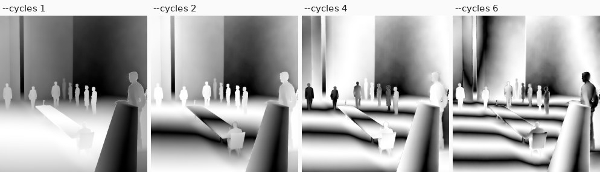
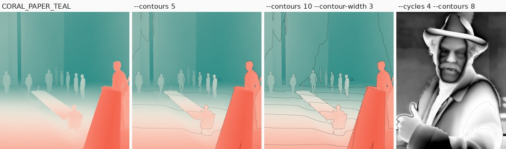
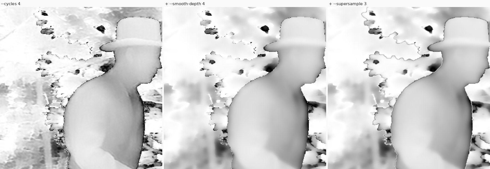
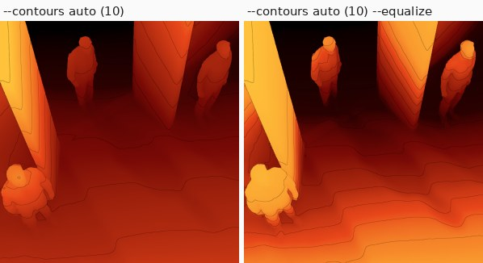
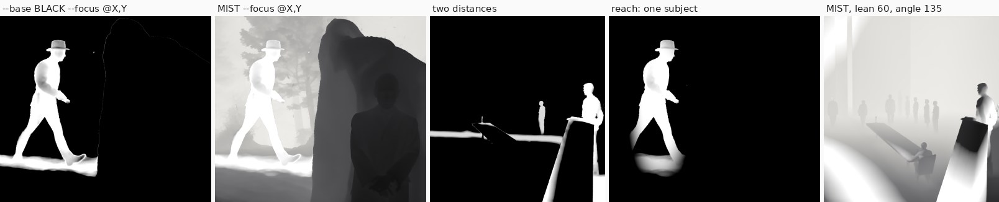

# Pictures: the look's settings

Everything that decides how a depth map becomes a picture, with the `vathopy render` options and the look keys
for each. The GUI has a control for each of these ([gui.md](gui.md)).

## The commands

```bash
# 1. Raw Marigold V2 prediction (.npy, float) -> clean depth map: near = bright, outliers clipped,
#    invalid pixels filled. Kinds: log (default), linear, disparity, near-bright, far-bright.
vathopy prep photo.npy --kind log -o photo_depth.exr

# 2. Render a look onto it (16-bit PNG by default; also png8, or exr for unclipped scene-linear).
vathopy init my_look.json --preset FRINGE_3_BW     # a starter look to edit
vathopy render photo_depth.exr -l my_look.json -o photo_vathograph.png

# Batch: several inputs into a folder; override the ramp without editing the look.
vathopy render shots/*_depth.exr -l my_look.json --preset VERMILION_INK_CYAN -o out/
```

The palettes are in [palettes.md](palettes.md), the look file in [look-file.md](look-file.md).

## How it works: the relief and the focal planes

The depth map becomes a **relief**: a surface in 3D whose left-right and up-down are the picture's and whose
height is the depth (near = high). The palette is painted onto that height, its left end (as the GUI shows a
swatch) on the nearest parts, its right end on the farthest, so in a plain render brightness means nearness,
not focus. Cycles repeat the palette through the depth, and the fringes are lines of equal depth.

A **focus** is a slab: a plane with a thickness (Width) and a soft edge (Softness), lying across the relief at
one depth, or tilted with Lean and Angle. Wherever the relief passes through the slab the picture is lifted to
white or sunk to black; with the white-on-black style everything else is black, so there bright does mean "in
focus". That slab is the add-on's Focus & Shape Band; "focal plane" is a good name for it.

vathopy can bend that plane into a **3D shape** ([Shape focuses](#shape-focuses)), and cut the relief away from the far side with the
**deletion slab**. The relief can also be printed (see [3d-printing.md](3d-printing.md)). Depth from Marigold is relative, not
measured, so shapes are round in the relief, not in real-world units; Depth scale sets how deep the scene is
compared with its width.
## Cycles and contour lines

Two render options that the add-on doesn't have (`N` is 1 to 10 in steps of 0.25):

```bash
vathopy render depth.exr --cycles 4 -o out/                                  # black/white 4-cycle fringe
vathopy render depth.exr --preset VERMILION_INK_CYAN --cycles 2.5 -o out/    # the colours repeat 2.5 times
vathopy render depth.exr --preset VERMILION_INK_CYAN --contours 5 -o out/    # gradient kept, 5 contour lines
vathopy render depth.exr --preset VERMILION_INK_CYAN --contours 5 --contour-strength 0.6 --contour-width 3 -o out/
```



- **`--cycles N`** repeats the ramp N times across the depth, mirroring every other repeat so there are no seams. One cycle is there and back, so whole numbers end on the ramp's far colour at the near end; use a half step (1.5, 2.5, …) to end on its near colour. With no `--preset` or look ramp it uses a black/white EASE ramp, which is the N-cycle fringe: more cycles means more contour bands. On smooth surfaces (floors, walls, open ground) 4–6 cycles read well; on noisy depth (sky, foliage, film grain) more cycles mostly magnify the noise.
- **`--contours N`** keeps the ramp as it is (so colour still means distance) and draws thin dark lines at N even steps through the depth, like a topographic map. `--contour-strength` (0–1, default 0.85) sets how dark they are, and `--contour-width` (pixels, default 2) their thickness. Lines keep that width everywhere: steep and gentle slopes alike, and on nearly flat surfaces where a depth-based width would smear into a wide band. Where many lines crowd into a pixel (steep depth edges) it gets their average darkness, and perfectly flat areas (such as the plateaus `prep` clipping leaves at the nearest and farthest values) get no line, just one around their rim.



Both are also look keys: `"cycles": 2.5` and `"contours": {"cycles": 5, "strength": 0.85, "width": 2}`. They're off by default, so other looks render exactly as before.

## Smoother contours

```bash
vathopy render depth.exr --preset VERMILION_INK_CYAN --contours 8 --smooth-depth 4 --supersample 3 -o out/
```

- **`--smooth-depth R`** smooths the depth map before rendering with an edge-preserving (bilateral) filter, radius R px (try 2–6). Small depth noise inside surfaces is evened out, so contour lines and fringes follow the surfaces in smooth curves instead of breaking up, while the steps between objects stay sharp. This is the main fix for ragged contours, especially on noisy depth (film scans, foliage, sky).
- **`--supersample N`** (1–4) anti-aliases: it renders at N× the resolution and averages back down, so line and edge pixels get in-between values instead of hard steps. It softens stair-stepped edges. It costs about N² in time, which is still well under a second per 1280 px picture at N = 3.



Both apply to everything (contours, cycles, bands, area edges), are look keys (`"smooth_depth": 4`, `"supersample": 3`), and are off by default. The output is always the depth map's own size.

## Clean edges

Where a near thing meets what's behind it, the depth model leaves a soft ramp a few pixels wide. With cycles
or a busy palette the colours run through that ramp, so the edge becomes a ragged line of stray colours, and
anti-aliasing only averages them. `edge_cleanup` turns the ramp along each edge into one clean step between
the two sides' own depths: each side takes the depth of the ground just beside the ramp, and the step goes where
the ramp crosses halfway, so it follows the edge smoothly. It runs at the anti-aliased size, so the step comes
out as a smooth line: `{"width": 4, "step": 0.05, "specks": 9, "enabled": true}`. `width` (0.5–8 px) is how far either side
of an edge it cleans; `step` (0.002–0.5 of the depth range, per pixel) is how big a jump has to be to count as
an edge; `specks` (0–400 map pixels, 0 keeps them) removes specks first: little groups of pixels whose depth
stands out from what's round them, like stray hairs the depth model left floating in the background, take
the depth round them. A surface that rolls away towards its outline (a head, a shoulder) is cleaned evenly along the edge
rather than pixel by pixel, so it isn't terraced, and gentle slopes away from edges are left alone. It's off
unless the look has it (the GUI starts with it on), and the 3D print uses it too.

## Probing a depth map for the most detail

```bash
vathopy probe depth.exr          # measure it and print recommended settings
vathopy render depth.exr --cycles auto --smooth-depth auto --supersample 3 -o out/
vathopy render depth.exr --preset EMBER_TO_BLACK --contours auto --smooth-depth auto --equalize -o out/
```

`vathopy probe` measures what limits detail and recommends the most contour lines or fringe cycles the map can carry cleanly:

- **Depth wobble:** gentle bumps a few to tens of pixels across in surfaces that should be smooth. A contour line drifts sideways by (wobble ÷ slope) pixels, and lines are (level step ÷ slope) pixels apart, so the slope cancels: lines tangle once the step between levels nears a few times the wobble. The number of clean levels is about 1 ÷ (34 × wobble). It's measured at the 80th percentile of the surfaces rather than the median, because lines look broken as soon as a sizeable region (a noisy sky, foliage) tangles, even if the rest is clean. One contour line per level; two light/dark edges per fringe cycle.
- **Smoothing:** recommended in proportion to the picture size (4 px at a 1280 px long edge).
- **Spread:** how much of the depth range the middle half of the pixels covers. Below 40%, most colours and contours land on a small part of the picture, and it suggests `--equalize`.

Calibrated on test photos: a grainy film scan comes out at about 5 cycles (where it visibly broke up), a photo with a noisy sky at 6.5, a clean portrait at 9. Every map tested supports at least 10 contour lines, the option's maximum. It's a ceiling for detail, not a style choice: fewer cycles can look better.

- **`auto`** for `--cycles`, `--contours` or `--smooth-depth` probes each depth map separately and prints what it chose (`auto: smooth-depth 4, cycles 6.5`).


- **`--equalize`** spreads the ramp by pixel count (histogram equalisation), so each colour band and contour level covers about the same share of the picture. It helps most on maps the probe flags, such as a dark room where most pixels sit in a narrow depth band. Look key: `"equalize": true`.
## Creative focus

Pick the distances that become the subject. Each `--focus` lifts one depth to white (or sinks it to black):

```bash
vathopy render depth.exr --base BLACK --focus 0.55:0.04:0.03 -o out/      # a white subject on black
vathopy render depth.exr --base BLACK --focus @410,480 -o out/            # the depth under pixel (410, 480)
vathopy render depth.exr --preset MIST --focus @410,480 -o out/           # lifted out of a misty gradient
vathopy render depth.exr --base BLACK --focus @410,480 --focus 0.9:0.1:0.05:0.6 -o out/   # several distances, the second at 60%
vathopy render depth.exr --base WHITE --focus 0.8:0.15 --focus-strength -1 -o out/   # black on white
vathopy render depth.exr --base BLACK --focus @410,480:reach_w=0.16:reach_h=0.5 -o out/   # one subject, isolated
vathopy render depth.exr --preset MIST --focus 0.6:angle=135:lean=60 -o out/   # a leaned band: a shaft of light
```

The practice's three kinds of focus: a **gradient** across the whole depth (`--preset MIST`, no focus), **one
subject isolated** (`--base BLACK` and a focus with a reach), and **several distances at once** (repeat `--focus`).



- **`--focus DEPTH[:WIDTH[:SOFTNESS[:STRENGTH]]]`**: DEPTH is a fraction of the depth range (0 = far, 1 = near),
  WIDTH the range that's fully in focus and SOFTNESS the fade on each side, as fractions too (default 0.1 and
  0.05). STRENGTH (-1 to 1) sets that focus alone. `@X,Y` instead of DEPTH takes the depth under that pixel
  (top-down coordinates of the depth map). Repeat `--focus` for several distances. Any field can also be
  named, in any order: `width=`, `softness=`, `strength=`, plus:
  - **`reach_w=` / `reach_h=`** (or `reach=` for both): confine the focus to an oval around the picked point,
    its half-width and half-height as fractions of the picture (0 = unlimited). Only that subject lights up,
    with a pool of light where the oval meets the ground, instead of everything at that depth.
    **`reach_edge=`** (0–1, default 0.5) softens the oval's edge towards a glow.
  - **`lean=`** (−90 to 90°, 0 = flat) tilts the band away from flat, so it cuts across the scene at an angle,
    like a shaft of light across a floor, through the picked point; negative leans tilt it the other way, and at
    ±90° it stands upright and ignores depth, a straight stripe across the picture. **`angle=`** (degrees,
    0 = right, 90 = up) turns it (any value; the GUI's slider runs −90 to 90°, since a negative lean covers the other
    half of the circle).
  - **`color=RRGGBB`** (sRGB hex) pushes the focus toward that colour instead of white, like the add-on's band
    colours; **`blend=`** sets how it goes over the picture: `normal` (becomes the colour), `multiply` (darkens),
    `screen` (lightens), `overlay`, `soft_light` or `color` (takes the hue, keeps the brightness). A coloured
    focus needs a positive strength (a negative one does nothing), and overlapping colours with the same blend
    average. `--base BLACK --focus 0.6:color=ff7a1a --focus 0.3:color=3399ff:blend=screen`: two distances in two
    colours.
- **`--base`** sets what the focus sits on: `RAMP` (default, the palette), `BLACK` or `WHITE`.
- **`--focus-strength K`** (-1 to 1, default 1) for every focus without its own STRENGTH: 1 lifts to white, -1
  sinks to black, in between is partial.
- **`MIST`** is a ramp for the third kind of focus: near dark, distance pale like mist.

Each focus is the add-on's own Focus & Shape Band at that depth (flat, or leaned), and a reach is the
add-on's mask area (an ellipsoid set to Keep) aimed at that band, so it renders exactly like the same setup
placed in Blender. Look key: `"focus": [{"depth": 0.55, "width": 0.04, "softness": 0.03}]` (or `"at": [x, y]`),
plus optional `"strength"`, `"enabled"`, `"lean"`, `"angle"`, `"pivot": [fx, fy]` (the point a leaned band or a
reach is centred on, as fractions of the picture; `at` sets it), `"reach_w"`, `"reach_h"`, `"reach_edge"`,
`"color"` (`[r, g, b]`, scene-linear 0–1, or null), `"color_blend"` and `"locked"` (the GUI's lock; no effect on
the picture).
## Shape focuses

A focus can be a sphere/ellipsoid, a box, a cylinder (a rod) or a double cone instead of a plane, placed at the
picked point and depth and turned with Lean/Angle (the cone's axis; the box's turn). A cylinder is a rod that
stands upright in the picture: Turn lays it over (90 = left-right), Tilt leans it towards you (90 = pointing at
you), Length is its height (0 = endless), and Depth moves it forward or back. **Shell**
lights a skin of the shape Width thick, the focal plane bent into the shape: rings and outlines where the scene
crosses it. **Solid** lights everything of the scene inside it. Sizes, Width and Softness are fractions of the
picture's width.

```bash
vathopy render depth.exr --base BLACK --focus @410,480:shape=ellipsoid:size=0.12:width=0.015 -o out/   # a ring
vathopy render depth.exr --base BLACK --focus @410,480:shape=box:size_x=0.1:size_y=0.2:size_z=0.1:fill=solid -o out/
vathopy render depth.exr --base BLACK --focus @410,480:shape=cone:cone=25:lean=60:angle=90 -o out/     # a beam
vathopy render depth.exr --base BLACK --focus @410,480:shape=cylinder:size=0.05:length=0.6 --depth-scale 2 -o out/
```
## The deletion slab

`--cut C` removes everything farther than C (0 = far … 1 = near, over the depth range) and turns it black or
white (`--cut-fill`), softly with `--cut-softness`. `--cut-near N` does the same from the near side: it removes
the nearest N of the depth range (0 = nothing, 1 = everything). Together they leave a band of depths. At 1
everything goes, except the **keep shapes**: spheres, boxes, rods or cones (`--keep`, the same fields as a shape
focus) that the cut leaves alone.

```bash
vathopy render depth.exr --cut 0.4 -o out/                                   # drop the background
vathopy render depth.exr --cut-near 0.3 -o out/                              # drop the foreground
vathopy render depth.exr --cut 0.3 --cut-near 0.3 -o out/                    # keep only the middle depths
vathopy render depth.exr --cut 1 --keep @950,480:size=0.25 -o out/           # only what's in a sphere around one person
```

The cut's `remove` list deletes whole things picked on the picture, whatever their depth: each part grows from its
`point` up to its depth edges like a [selection](#selections), but only over what the slab has left, so a click on a
patch the slab didn't quite reach takes just that patch. Thin slivers left along its edge go with it. Keep
shapes don't hold on to removed parts. In a look: `"cut": {"depth": 0.21, "remove": [{"point": [0.5, 0.03]}]}`.
## Selections

A selection picks out a person or thing by its depth, and gives it its own palette and cycles. It grows from a
point (`point`, fractions of the picture, top-down) over neighbouring pixels whose depth changes by at most
`step` (a fraction of the depth range) from one pixel to the next, so it stops at depth edges such as someone's
outline. Lower `step` stops at fainter edges. `range` also keeps it within that much depth of the point,
`floors` stops it spreading onto ground that comes nearer going down the picture (the floor under someone's
feet), `grow` widens it by some pixels and `softness` feathers its edge. Small pockets left inside are filled.
`invert` selects everything else. There's no `render` flag for it: put it in a look (`-l`), or use the GUI.

```json
{"ramp": {"preset": "WHITE_TO_BLACK"}, "cycles": 2,
 "selections": [{"point": [0.25, 0.5], "step": 0.003, "floors": true, "ramp": {"preset": "COPPER_TO_BLACK"}, "cycles": 3}]}
```

It works from depth alone, so a person standing against a wall at the same depth can't be told from it; lower
`step` helps where there's a small depth step between them. The growth runs on the depth map at most 1536 px
across, so a preview and the full render select the same pixels.
## Photo overlay

`overlay` blends the photo the depth map was made from over the picture, under the cut: `opacity` 0–1, `mode`
`normal`, `multiply`, `screen` or `soft_light`, `where` `all`, `selections` (only inside them) or `outside`, and
`grey` for black and white, `invert` for its negative, and `enabled` (false keeps the settings but hides it).
The photo isn't stored in the look; give it to `render`:

```bash
vathopy render depth.exr -l look.json --photo photo.jpg --overlay 0.4 -o out/
```

It's resized to the depth map and turned upright from its EXIF orientation. The GUI finds it by name ([gui.md](gui.md), Photo).
## Viewpoint shift

`view_shift` looks at the scene from a little to one side: `{"x": -1..1, "y": -1..1, "strength": 0.05, "pivot":
0.5, "edges": "zoom"}`. Each pixel moves by its depth, near ones one way and far ones the other, as if the camera
moved right (x > 0) or up (y > 0); `strength` is how far, as a share of the picture's width, and the depth at
`pivot` (0 = far … 1 = near) stays put. The soft in-between pixels along depth edges are left out (they'd smear
across), and the gaps that open behind near things are filled smoothly from the background beside them. With
`edges` `zoom` the picture is enlarged just enough that the strips the move uncovers along its borders (where
there's no data) fall outside it; `fill` keeps the framing and fills them too. It acts on the depth map (and
the overlay photo) first, so fringes, focuses and the cut all follow the new view; focus points, keep shapes and
selections stay where they were picked.
## Exaggerated depth

`exaggerate` makes the relief more pronounced: `{"amount": 0-10, "size": 0.002-0.2, "enabled": true}`. Each pixel's difference
from its smoothed surroundings (over `size` × the picture's width) is multiplied by 1 + `amount`, so faces,
folds and bumps stand out more, while the steps between things (more than 5% of the depth range) stay as they
are, with no halos. The result is scaled back into the depth's own range. It also amplifies the depth model's
own fine noise; a little smoothing (`smooth_depth`, applied first) keeps that down. `vathopy relief` uses it
too (the look's, or `--exaggerate A --detail-size S`).
## Local contrast

`local_contrast` brings out small shapes against the big steps between things, edge-aware:
`{"amount": 0-1, "range": 0.01-0.5, "compress": 0-0.9, "enabled": true}`. It's a local Laplacian filter
(Paris, Hasinoff & Kautz 2011, in the fast sampled form of Aubry et al. 2014) run on the depth after
`exaggerate`:

- **`amount`:** around each pixel, depth differences smaller than `range` (a share of the depth range) count
  as detail and are boosted, more with a higher `amount`. Edges stay sharp, with no halos.
- **`compress`:** also shrinks the bigger differences, the steps between things, so near and far come closer
  together. That tilts the surfaces beside each step towards each other, so it's off by default.

The result is scaled back into the depth's own range. It runs before the palette, so colours stay on the ramp,
and the 3D view and 3D print use it too. CLI: `vathopy render ... --local-contrast 0.5 [--lc-range 0.1]
[--lc-compress 0.3]` (also on `vathopy relief`).

## Reshaping

`reshape` changes the depth map itself before anything else, so the picture, the 3D view and the 3D print all
follow it, and the photo overlay moves with it. It's a list, applied in order; each item has a `kind`:

- **`scale`** (Grow / shrink): makes a thing bigger or smaller (`scale` 0.25–3) about its middle or, with
  `"anchor": "bottom"`, its bottom (feet stay on the ground). Growing covers what's round it; shrinking fills
  what it uncovers from the background around it. It goes behind things that are nearer than it.
- **`depth`** (Nearer / farther): moves a thing nearer (`offset` > 0) or farther (< 0), as a share of the depth
  range (−0.5 to 0.5), and makes its own relief deeper or flatter (`relief`, 0–3, 1 = as it is).
- **`bulge`**: swells what's within `radius` (a share of the picture's width) of `point` (`amount` > 0, up to 1)
  or pinches it (< 0). The middle grows most; the edge of the brush stays put.
- **`push`**: moves what's round `point` by `distance` (a share of the width, up to 0.5) towards `angle`
  (degrees: 0 = right, 90 = up), fading out at `radius`. Pushing a hand outward stretches the arm.

`scale` and `depth` pick a thing like a [selection](#selections) (`point`, `step`, `range`, `floors`, `grow`,
`softness`, `invert`) plus **`size`**: how far from the point it reaches, measured along the surface, as a share
of the picture's width (0 = everything joined to it). Since it follows the surface, a small size takes the arm
you clicked and stops before it reaches the other one across the body, though both are at the same depth.
Where the size cuts across a surface (a shoulder) the edit fades out; where the thing meets something at
another depth the edge stays sharp, so no stripes of colour appear there.

`bulge` and `push` work on everything under the brush. With **`"only": true`** they work only on the thing they
pick (the same fields as `scale` and `depth`): the arm swells or stretches over the background, and the
background stays as it is instead of bending with it.

```json
{"cycles": 4, "edge_cleanup": {},
 "reshape": [{"kind": "scale", "point": [0.34, 0.08], "size": 0.05, "scale": 1.5},
             {"kind": "push", "point": [0.6, 0.4], "radius": 0.08, "distance": 0.03, "angle": 180}]}
```

`vathopy relief` prints the reshaped depth; `--no-reshape` prints the map's own shapes instead.
